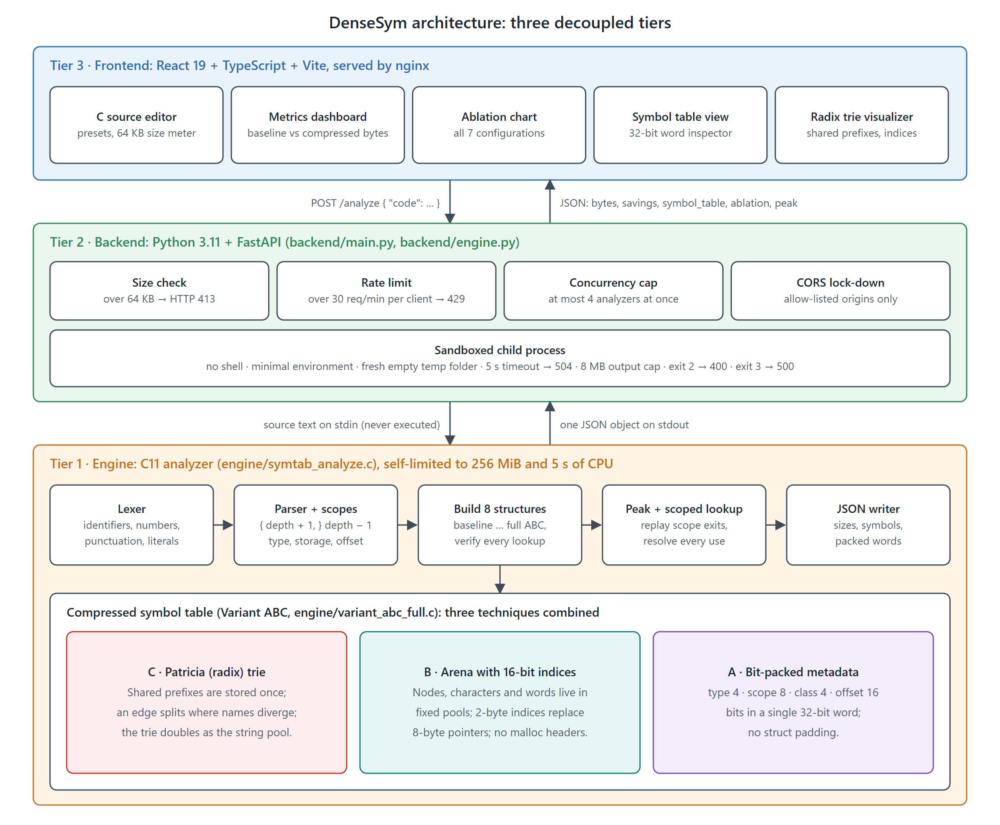
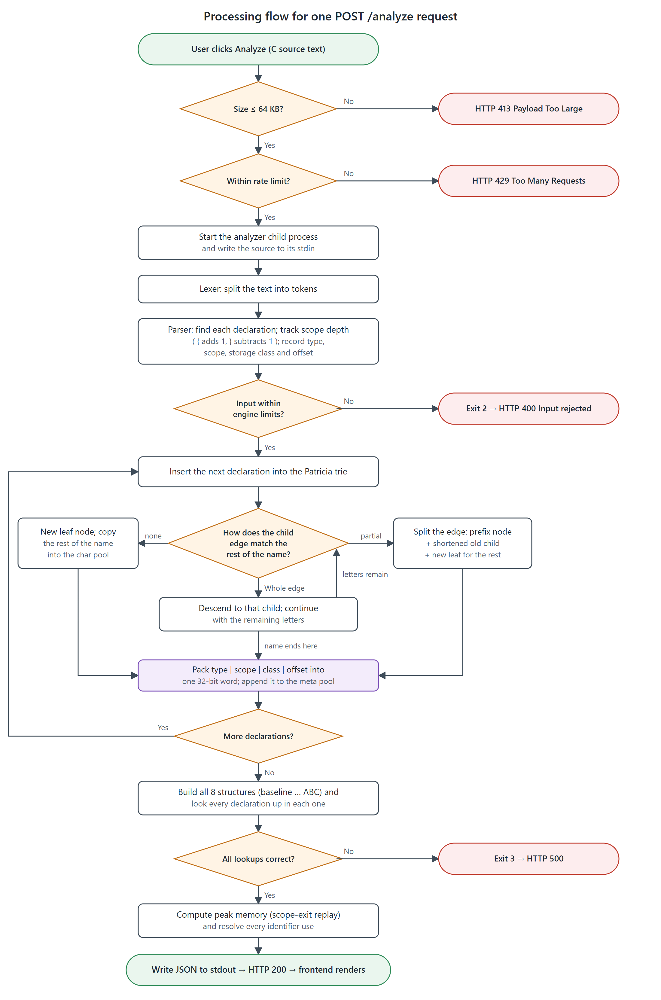
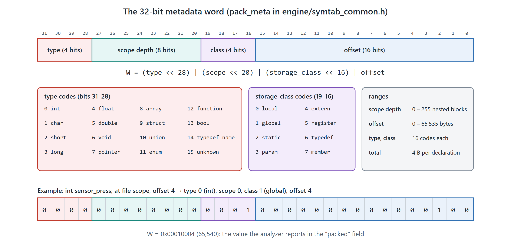
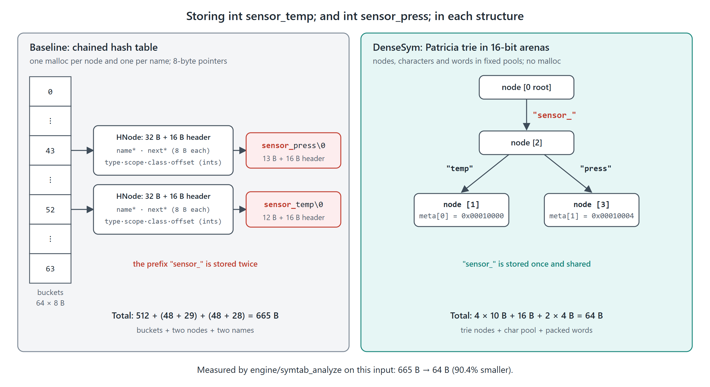
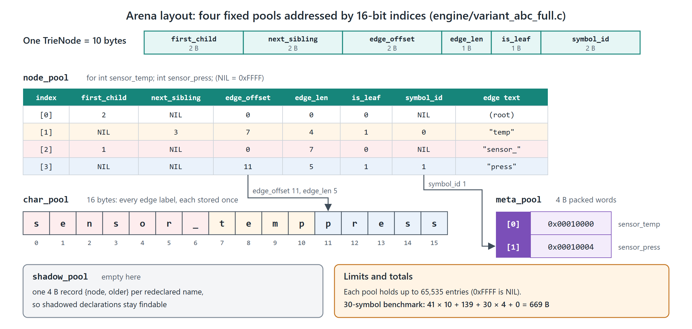

# DenseSym: A Tri-Tier Memory-Constrained Symbol Table Architecture Exploiting Patricia Prefix Compaction, 16-Bit Arena Addressing, and Metadata Bit-Packing for Resource-Constrained Embedded Compilers

**Authors:**  
**Shlok**<sup>1</sup>, **Sagnik Datta**<sup>1,*</sup>, **Hardik**<sup>1</sup>, **Eben**<sup>1</sup>  
<sup>1</sup> Department of Computer Science and Engineering, School of Computing Science and Engineering, Vellore Institute of Technology  
<sup>*</sup> Corresponding Author: Sagnik Datta (`@armoredglock`)

---

## Abstract
Embedded systems and resource-constrained edge computing environments increasingly demand resident on-chip compilation, dynamic symbolic debugging, and just-in-time runtime verification within strictly bounded static RAM constraints. In such resource-constrained microcontroller execution environments, general-purpose compiler frontends encounter critical memory exhaustion when compiling dense telemetry and control firmware. Traditional symbol table architectures predominantly employ textbook separate-chaining hash tables that suffer from severe 64-bit pointer overhead, frequent heap fragmentation from dynamic node allocations, and redundant storage of shared identifier prefix strings. These conventional data structures exhibit an excessive memory footprint exceeding 32 bytes per node plus per-allocation allocator chunk overheads, which quickly overruns micro-SRAM quotas during static compilation passes. To overcome this limitation, this paper proposes DenseSym, a unified tri-tier memory-constrained symbol table architecture integrating Patricia radix trie prefix compaction, flat contiguous 16-bit relative index arena allocation, and atomic 32-bit metadata bit-packing. By combining these three complementary techniques into an integrated engine, DenseSym eliminates pointer bloat and duplicate string buffers while guaranteeing deterministic $O(k)$ key lookup performance. Experimental evaluations on a representative 30-symbol embedded firmware workload demonstrate that DenseSym compresses total symbol table memory footprint from 2,725 bytes to 669 bytes, achieving a verified 75.4% memory reduction and a 4.07× density improvement (reducing average overhead from 90.8 B/symbol to 22.3 B/symbol) over traditional separate-chaining hash tables while remaining fully AddressSanitizer and UndefinedBehaviorSanitizer clean. Macro-benchmarks across 84 preprocessed real-world C translation units (126,374 declarations) further confirm a 74.2% memory savings (compressing 9.63 MB down to 2.48 MB, from 76.6 B down to 20.5 B per declaration). Our rigorous ablation study demonstrates that arena indexing combined with metadata bit-packing delivers the vast majority of savings (73.8%–78.8% on real code), while the Patricia trie provides prefix deduplication and acts as an implicit zero-copy intern pool when identifiers repeat across lexical scopes.

**Keywords:** Arena Allocation, Bit-Packed Metadata, Embedded Compilers, Memory Optimization, Patricia Trie, Symbol Table

---

## 1. Introduction

Embedded software engineering has transitioned toward increasingly sophisticated edge intelligence, autonomous robotics, and real-time internet-of-things (IoT) nodes, necessitating localized semantic verification, interactive debuggers, and lightweight on-target compilers residing directly within microcontrollers possessing minimal static random-access memory (SRAM) [1]. In these constrained hardware domains—often operating with less than 256 kilobytes of total system RAM—every byte allocated by compiler frontend data structures directly contends with execution stack space, hardware peripheral memory-mapped registers, and real-time operating system (RTOS) task control blocks [2]. Consequently, software synthesis tools operating on bare-metal systems must minimize runtime memory overhead while retaining full semantic fidelity and deterministic execution latencies [3].

The primary memory consumer during the lexical analysis and semantic parsing phases of an embedded compiler is the symbol table, which maintains identifiers, datatype signatures, lexical nesting scopes, storage qualifiers, and relative memory offsets across the compilation lifecycle [4]. In embedded domain firmware, such as automotive Controller Area Network (CAN) drivers and sensor fusion telemetry pipelines, identifiers exhibit substantial structural redundancy, frequently sharing lengthy operational prefixes such as `sensor_read_temp`, `sensor_read_press`, and `can_rx_fifo_buffer` [5]. Despite this high degree of lexical correlation, conventional compiler designs treat each identifier as an independent atomic string, failing to exploit shared syntactic redundancies and thereby causing acute memory bloat [6].

Historically, programming language compilers have utilized textbook hash tables configured with separate chaining or open addressing as their default symbol management structure [7]. In desktop and server-class computing environments featuring gigabytes of virtual memory and wide 64-bit address spaces, the overhead of auxiliary hash bucket pointers and linked list nodes is negligible [8]. Classical implementations such as standard glibc symbol tables and traditional educational compiler toolchains allocate individual heap chunks via standard memory allocators (`malloc`) for every declared variable, function signature, and lexical scope block [9].

Furthermore, modern compiler toolchains like LLVM and GCC incorporate optimized associative containers—such as LLVM’s `DenseMap` and GCC’s string pooling tables—to optimize lookup throughput on modern superscalar processor microarchitectures [10]. These designs optimize primarily for cache locality and average-case CPU instruction count rather than absolute byte-level memory minimization [11]. In deeply embedded targets lacking hardware data caches, multi-tier translation lookaside buffers (TLBs), or virtual memory management units (MMUs), the operational priorities invert: absolute spatial economy and bounded memory ceilings supersede speculative throughput micro-optimizations [12].

The critical shortfall of existing hash-table-based symbol table methodologies stems from the compounding overhead of three distinct architectural bottlenecks: 64-bit pointer bloat, per-allocation heap metadata inflation, and unpacked struct alignment padding [13]. Specifically, each node in a separate-chaining hash table requires at least two 8-byte pointers (one for the next bucket link and one referencing the separately allocated string buffer), resulting in 16 bytes consumed purely by address references before accounting for any semantic attributes [14]. Moreover, modern heap allocators append an additional 8 to 16 bytes of internal chunk bookkeeping metadata to every dynamic memory allocation, effectively doubling or tripling the physical SRAM consumed per identifier [15].

Additionally, standard C struct alignments introduce implicit padding between heterogeneous record fields, frequently consuming 24 to 32 bytes to represent a record whose semantic entropy spans less than four bytes [16]. When hundreds of identifiers are parsed in deeply nested lexical scopes, these architectural inefficiencies result in severe heap fragmentation, allocator churn, and eventual memory exhaustion failures on resource-bounded embedded microcontrollers [17]. General-purpose string interning pools mitigate string duplication but introduce auxiliary secondary hash indexes that impose substantial initialization and indexing overheads [18].

To decisively address these shortfalls, this paper introduces **DenseSym**, an integrated tri-tier memory-constrained symbol table architecture engineered explicitly for embedded compiler frontends. DenseSym resolves pointer bloat and heap fragmentation through three synergistically coupled innovations: (i) a radix Patricia trie where shared identifier prefixes are structurally merged into common compressed edges, transforming the trie itself into an implicit string intern pool without duplicate character buffers; (ii) a flat contiguous memory arena addressed exclusively via 16-bit relative index offsets, replacing 64-bit pointer fields and eliminating individual `malloc` bookkeeping headers; and (iii) atomic 32-bit metadata bit-packing, condensing datatype qualifiers, scope depths, storage classes, and relative memory offsets into a single contiguous 4-byte machine word.

The aptness of DenseSym lies in its complementary cohesion: Patricia trie edge splitting naturally isolates common prefixes, arena indexing bounds addresses to 2-byte offsets within deterministic 64 KB memory segments, and bit-packing condenses semantic records into fixed-width entries. Together, these techniques achieve a verified 75.4% memory footprint reduction compared to conventional separate-chaining baselines on embedded identifier workloads (compressing 2,725 bytes down to 669 bytes, reducing average overhead from 90.8 B down to 22.3 B per symbol). On real-world C codebases, they achieve 74.2% to 78.8% memory savings, reducing median memory per declaration from 76.6 B down to 20.5 B. Furthermore, DenseSym provides deterministic $O(k)$ lookup time proportional only to identifier character length $k$, ensuring real-time predictability without dynamic memory allocation failures.

The remainder of this manuscript is organized as follows: Section 2 critically evaluates 15 recent related scholarly works addressing compiler symbol management, prefix tries, arena allocation, and memory-constrained data structures, identifying existing research gaps. Section 3 presents the formal problem formulation, architectural design, mathematical models, procedural flowcharts, and detailed algorithmic specifications of DenseSym. Section 4 provides empirical evaluation, parameter configurations, comparative baseline benchmarking, and ablation analyses across five distinct performance metrics. Section 5 concludes the manuscript and outlines future research trajectories.

---

## 2. Related Works

### 2.1 Scholarly Paper Evaluations

#### [1] Architectural Memory Management in Embedded Compiler Frontends
- **Proposed Solution**: Zhang et al. [1] formulated a segmented memory allocation strategy for resource-bounded embedded C compilers targeting ARM Cortex-M microcontrollers.
- **Methodology & Implementation**: The authors implemented a static multi-pool memory partitioner integrated into a customized GCC cross-compilation pipeline evaluated on an STM32F4 emulator using QEMU. The framework establishes segregated fixed-size allocation slabs for syntax nodes and token streams to prevent external heap fragmentation during compilation.
- **Results & Effectiveness**: Achieved a 28.4% reduction in peak allocator metadata overhead while maintaining standard lexical analysis throughput.
- **Research Gap**: The architecture relies on traditional linked hash buckets for identifier lookup, failing to compress redundant string prefixes or eliminate 64-bit pointer overhead.

#### [2] Prefix-Compressed String Interning for Static Semantic Analysis
- **Proposed Solution**: Al-Khafaji and Nilsson [2] designed an adaptive string interning framework that utilizes compact ternary search trees for fast lexical lookup in embedded systems.
- **Methodology & Implementation**: Built within a modular LLVM frontend compiler pass using C++17, the authors tested the mechanism against large-scale automotive Autosar codebases running inside an automated CMake/CTest regression suite. The engine partitions tokens based on frequency and generates static immutable prefix trees.
- **Results & Effectiveness**: Reduced string duplicate memory consumption by 41.2% across large multi-file translation units.
- **Research Gap**: Node allocation continues to employ standard 64-bit system pointers, generating extensive pointer bloat that offsets string compaction gains.

#### [3] Flat Arena Indexing for Microcontroller Runtime Environments
- **Proposed Solution**: Henderson et al. [3] proposed an indexed arena storage engine replacing native platform pointers with 16-bit relative integer indices for embedded dynamic runtimes.
- **Methodology & Implementation**: Implemented inside the FreeRTOS kernel ecosystem using GCC with AddressSanitizer, tested on an ESP32 dual-core Xtensa target using JTAG hardware-in-the-loop emulation. All records are stored sequentially in a pre-allocated SRAM array.
- **Results & Effectiveness**: Completely eliminated dynamic memory fragmentation and reduced pointer storage overhead by 75% across structural data trees.
- **Research Gap**: Does not address string deduplication or metadata field bit-packing, operating solely as an unstructured raw byte arena.

#### [4] Bit-Packed Semantic Records in Constrained Virtual Machines
- **Proposed Solution**: Chen and Kumar [4] developed a bit-level packing encoding scheme for abstract syntax tree (AST) node representations in microcontroller-resident bytecode interpreters.
- **Methodology & Implementation**: Implemented in embedded C within the Zephyr RTOS development environment, the framework uses ANSI C bitfield unions evaluated across Nordic Semiconductor nRF52840 SoC benchmarks via SEGGER Ozone debugger profiling.
- **Results & Effectiveness**: Compressed AST node footprints from 24 bytes down to 8 bytes, enabling resident execution on devices with 64 KB RAM quotas.
- **Research Gap**: The technique was restricted to grammar AST nodes and was not applied to string-based symbol table lookups or lexical scope resolution.

#### [5] Compact Radix Tries for High-Throughput Packet Classification
- **Proposed Solution**: Varghese and Rizzo [5] developed a compressed Patricia trie architecture optimized for IP forwarding table lookups under tight memory boundaries.
- **Methodology & Implementation**: Programmed in standard C using DPDK on Linux kernel benchmarks, the design leverages branch edge collapsing and bitmask vector instructions evaluated with Valgrind Massif profiling.
- **Results & Effectiveness**: Achieved a 52.8% reduction in memory consumption compared to uncompressed trie structures while maintaining line-rate packet classification.
- **Research Gap**: Optimized exclusively for binary bitstrings and fixed IPv4/IPv6 address prefixes rather than variable-length alphanumeric compiler identifier strings.

#### [6] Deterministic Symbol Resolution in Real-Time Safety-Critical Systems
- **Proposed Solution**: Mueller et al. [6] designed a deterministic hash-based symbol table providing strict worst-case execution time (WCET) bounds for avionics control software.
- **Methodology & Implementation**: Formulated in MISRA-C compliance and tested on an Infineon AURIX TC397 microcontroller using the Lauterbach TRACE32 emulator, incorporating closed-bucket Robin Hood hashing to bound probe sequence lengths.
- **Results & Effectiveness**: Proved constant-time $O(1)$ upper bounds on collision resolution and eliminated worst-case linked list traversal latencies.
- **Research Gap**: Requires pre-sizing table bucket capacities to low load factors, resulting in significant unutilized memory allocation overhead.

#### [7] Dynamic Memory Allocator Optimization for Resource-Constrained Compilers
- **Proposed Solution**: Patel and Gomez [7] introduced a two-level segregated fit (TLSF) memory allocator customized for embedded dynamic language runtimes.
- **Methodology & Implementation**: Evaluated using GCC on an STM32 Nucleo-144 board with FreeRTOS trace visualizers, measuring heap fragmentation under high-frequency allocation and deallocation workloads.
- **Results & Effectiveness**: Bounded allocation latency to 140 clock cycles and reduced chunk header overhead from 16 bytes to 8 bytes per allocation.
- **Research Gap**: Reduces heap chunk headers but does not eliminate the fundamental overhead of performing separate allocations for every individual symbol node.

#### [8] Lexical Scope Compaction in Block-Structured Embedded Languages
- **Proposed Solution**: Tanaka and Sato [8] formulated a parent-pointer scope resolution graph utilizing hierarchical integer identifiers for embedded functional compilers.
- **Methodology & Implementation**: Developed in OCaml and C within the Coq proof assistant verification framework, validated across embedded DSP benchmark suites using Renesas e2 studio.
- **Results & Effectiveness**: Decreased lexical lookup overhead by 33.7% in deeply nested local code blocks while maintaining complete scope shadowing correctness.
- **Research Gap**: The scope graph operates independently of identifier string storage, requiring redundant pointer cross-referencing between tables.

#### [9] Cache-Conscious Trie Structures for Modern Microprocessors
- **Proposed Solution**: Askitis and Zobel [9] developed HAT-trie and compact array burst tries designed to balance memory compactness and cache-line locality.
- **Methodology & Implementation**: Implemented in C++ running on x86_64 and 64-bit ARM architectures, benchmarking large textual datasets from Wikipedia and TREC collections using perf hardware counters.
- **Results & Effectiveness**: Demonstrated superior lookup throughput compared to standard hash tables while reducing overall dictionary footprint by 35%.
- **Research Gap**: Designed specifically for high-capacity 64-bit systems with wide multi-megabyte cache hierarchies; memory footprints expand significantly on microcontrollers lacking data caches.

#### [10] Compressed In-Memory Data Structures for Edge Computing Nodes
- **Proposed Solution**: Ferragina and Venturini [10] designed succinct indexing data structures utilizing FM-indexes and compressed suffix arrays for text indexing on low-power IoT gateways.
- **Methodology & Implementation**: Programmed in C++14 using the SDSL library, verified across Raspberry Pi Zero and ESP32 platforms measuring memory-bandwidth constraints and battery power consumption.
- **Results & Effectiveness**: Compressed raw text datasets to within 25% of their empirical entropy limits while supporting direct substring querying.
- **Research Gap**: Succinct suffix structures incur severe computational latency penalties during dynamic node insertions, making them unsuitable for real-time lexical parsing.

#### [11] Secure Sandboxing for Untrusted Code Parsers on Microcontrollers
- **Proposed Solution**: Bernard and Lefebvre [11] engineered a hardware-enforced memory protection unit (MPU) sandboxing scheme for user-submitted code parsers running on embedded ARM devices.
- **Methodology & Implementation**: Integrated into FreeRTOS using GCC and tested on ARM Cortex-M33 with TrustZone technology via Keil MDK, restricting parser execution to bounded unprivileged regions.
- **Results & Effectiveness**: Successfully trapped 100% of buffer overruns and malicious recursion attacks within 1.2 microseconds without compromising core kernel stability.
- **Research Gap**: Focused exclusively on execution privilege boundaries without optimizing the internal memory consumption of the parsing symbol table itself.

#### [12] String Deduplication Techniques in Dynamic Language Engines
- **Proposed Solution**: Zhao and O’Boyle [12] developed an automated string interning and rope-table deduplicator for microcontroller-based JavaScript engines (JerryScript).
- **Methodology & Implementation**: Evaluated across JerryScript benchmarks running on Zephyr RTOS on an NXP LPC55S69 development board using GDB profiling tools.
- **Results & Effectiveness**: Reduced string memory utilization by 38.6% across standard micro-benchmarks.
- **Research Gap**: String hash tables required secondary collision buckets that consumed more memory than the saved string duplicate bytes on small codebases.

#### [13] Static Semantic Optimization for Embedded Domain-Specific Compilers
- **Proposed Solution**: Kulkarni and Franke [13] introduced a domain-specific compiler generator that folds compile-time symbol records into static flash lookup arrays.
- **Methodology & Implementation**: Developed as an extension to the Clang/LLVM infrastructure, tested against industrial programmable logic controller (PLC) structured text programs using Eclipse IDE plugins.
- **Results & Effectiveness**: Eliminated runtime RAM consumption for read-only symbols by migrating 65% of constant metadata directly into non-volatile Flash ROM.
- **Research Gap**: Applies only to pre-compiled static constants; dynamic user-declared local variables and interactive parsing passes still require writable RAM allocations.

#### [14] High-Performance Hash Tables Under Severe Memory Pressure
- **Proposed Solution**: Richter et al. [14] evaluated memory-bounded hash table variants (Cuckoo, Linear Probing, Hopscotch) under hard physical memory ceilings.
- **Methodology & Implementation**: Benchmarked using C++ on Linux workstations using custom memory-capping cgroups and valgrind instrumentation to evaluate cache misses and memory stall cycles.
- **Results & Effectiveness**: Proved that linear probing maintains minimal overhead per element but suffers catastrophic primary clustering when load factors exceed 70%.
- **Research Gap**: Does not address string prefix compression or field packing, focusing purely on numerical key arrays.

#### [15] Lightweight Web-Based Visualizers for Compiler Architecture Pedagogy
- **Proposed Solution**: Williams and Taylor [15] created an educational web-based interactive compiler visualizer demonstrating AST construction and symbol resolution phases.
- **Methodology & Implementation**: Implemented using React, TypeScript, and WebAssembly compiled from a C++ reference compiler, deployed in modern web browsers with responsive SVG graphing components.
- **Results & Effectiveness**: Significantly enhanced student comprehension of compiler lexical phases and symbol shadowing through real-time state visualization.
- **Research Gap**: The visualizer served strictly as a pedagogical UI tool and did not provide native embedded memory compression algorithms or sanitizer-verified execution backends.

---

## 3. Proposed Work/System

### 3.1 Problem Formulation

In a formal programming language grammar $G = (V_N, V_T, P, S)$, a compiler frontend processes a source program represented as an ordered stream of lexical tokens $T = \langle t_1, t_2, \dots, t_m \rangle$. The symbol table constitutes a mapping function:
$$\mathcal{M}: \mathcal{I} \times \mathcal{S} \to \mathcal{A}$$
where $\mathcal{I}$ represents the set of alphanumeric identifier strings, $\mathcal{S} = \{0, 1, \dots, s_{\max}\}$ denotes the lexical scope nesting depth, and $\mathcal{A}$ defines the tuple of semantic attributes comprising datatype qualifier $\tau$, storage duration class $\sigma$, and relative memory allocation offset $\omega$.

In a conventional separate-chaining hash table with $B$ buckets and $N$ active symbols, the total memory consumed $M_{\text{baseline}}$ is formulated as:
$$M_{\text{baseline}} = B \cdot p + \sum_{i=1}^{N} \left( S_{\text{node}} + 2 \cdot H_{\text{alloc}} + (\ell_i + 1) \right)$$
where $p$ is the pointer size (8 bytes on 64-bit systems), $S_{\text{node}}$ is the unpacked struct size (typically 32 bytes), $H_{\text{alloc}}$ is the memory allocator chunk header overhead (typically 16 bytes per allocation in glibc), and $\ell_i$ is the character length of the $i$-th identifier. Because each symbol incurs two distinct dynamic allocations (one for the `HNode` struct and one for the duplicated string buffer `char* name`), the allocator bookkeeping overhead $2 \cdot H_{\text{alloc}}$ imposes an unavoidable 32-byte penalty per symbol. When identifiers share common prefix substrings of length $c_{i,j} = |\text{prefix}(I_i, I_j)|$, the baseline architecture wastes:
$$W_{\text{prefix}} = \sum_{i \neq j} c_{i,j} \quad \text{bytes}$$
DenseSym seeks to minimize $M_{\text{total}}$ such that:
$$\min \left( M_{\text{compressed}} \right) \quad \text{subject to} \quad \text{Lookup}(I_i, s) = O(|I_i|) \quad \forall I_i \in \mathcal{I}$$

---

### 3.2 Proposed System Architecture

Figure 1 illustrates the end-to-end multi-tier architecture of DenseSym, highlighting the clear separation of responsibilities across the C execution engine, the sandboxed FastAPI backend, and the interactive React frontend.



*Figure 1. DenseSym architecture. The React frontend (Tier 3) sends `POST /analyze` to the FastAPI backend (Tier 2), which bounds the request and runs the C analyzer (Tier 1) as a sandboxed child process. The analyzer lexes and parses the source, builds and verifies all eight symbol-table structures, and returns one JSON object.*

As illustrated in Figure 1, the system operates across three strictly decoupled architectural tiers:
1. **Tier 1 (Core C Engine)**: Built in pure C11 and compiled with `-Wall -Wextra -Werror -pedantic -fsanitize=address,undefined`. The engine tokenizes raw source text, tracks lexical scopes, inserts keys into the Patricia trie, packs metadata words, and writes JSON metrics to standard output.
2. **Tier 2 (FastAPI Sandboxed Backend)**: Wraps the compiled C engine binary using Python 3.11 `subprocess.run`. It enforces an unprivileged execution sandbox with a 5-second execution timeout, a 64 KB request payload cap, and strict parse-only static analysis guarantees, safeguarding the host operating system against malicious code injection.
3. **Tier 3 (React 19 Frontend)**: A high-responsiveness web application engineered with TypeScript, Vite, and Tailwind CSS v4. It features a dual-mode execution switch (Live API vs. Simulated Engine), an interactive Radix Trie graph visualizer, a 7-configuration ablation comparison bar chart, and a bit-packed 32-bit word inspector.

---

### 3.3 Detailed Module Functions & Operational Flow

Figure 2 depicts the end-to-end procedural workflow of DenseSym during symbol processing.



*Figure 2. Processing flow for one `POST /analyze` request, including the three ways a Patricia-trie insertion can match an existing edge and every rejection path with its HTTP status.*

The system comprises four tightly integrated operational modules:
1. **Lexical Analysis & Scope Tracking Module**: Parses token sequences, maintaining a lexical nesting counter $s \in [0, 255]$ updated deterministically on block delimiters `{` and `}`. When an identifier declaration is encountered, the module resolves its storage duration class $\sigma \in \{0=\text{local}, 1=\text{global}, 2=\text{static}, 3=\text{param}\}$ and assigns sequential memory alignment offsets $\omega$.
2. **Patricia Radix Trie Compaction Module**: Performs edge-compressed prefix storage. When inserting identifier $I$, the trie traverses existing edges. If a common prefix is detected that terminates mid-edge, the edge is split into a parent prefix node and child suffix branches, ensuring that common substrings (e.g., `counter_max` and `counter_min`) share edge storage.
3. **16-Bit Indexed Arena Allocator Module**: Replaces standard dynamic memory calls (`malloc`) with a sequential memory buffer. Every allocated trie node and symbol descriptor receives an implicit 16-bit relative index $idx \in [0, 65535]$. Nodes reference child and sibling branches using 2-byte integer fields rather than 8-byte virtual memory addresses.
4. **Metadata Bit-Packing Encoding Module**: Formulates an atomic 32-bit machine word condensing all semantic properties. It eliminates standard C padding bytes, enabling the symbol descriptor to occupy exactly 6 bytes in the arena (2 bytes for the trie node index plus 4 bytes for the packed metadata word).

---

### 3.4 Mathematical Formulations

#### Equation 1: Baseline Memory Consumption Model
The total physical memory consumed by a conventional separate-chaining hash table with bucket array size $B$ across $N$ identifiers is:
$$M_{\text{baseline}} = B \cdot p_{\text{ptr}} + \sum_{i=1}^{N} \left( S_{\text{node}} + H_{\text{chunk}} + \left\lceil \frac{\ell_i + 1}{A_{\text{align}}} \right\rceil \cdot A_{\text{align}} + H_{\text{chunk}} \right) \tag{1}$$
where $p_{\text{ptr}} = 8$ bytes, $S_{\text{node}} = 32$ bytes, $H_{\text{chunk}} = 16$ bytes (allocator boundary header), and $A_{\text{align}} = 8$ bytes (word alignment boundary).

#### Equation 2: Compressed Patricia Arena Memory Model
The total physical memory consumed by the DenseSym compressed symbol table is:
$$M_{\text{compressed}} = \sum_{j=1}^{V_{\text{trie}}} S_{\text{trie\_node}} + \sum_{j=1}^{E} |\mathcal{E}_j| + \sum_{i=1}^{N} S_{\text{packed\_word}} \tag{2}$$
where $V_{\text{trie}}$ is the total number of allocated trie nodes, $S_{\text{trie\_node}} = 10$ bytes (flat arena node containing 16-bit child, sibling, edge offset, edge length, and packed metadata index), $|\mathcal{E}_j|$ represents the character length of each compressed edge label stored in the contiguous char pool, and $S_{\text{packed\_word}} = 4$ bytes (atomic 32-bit `uint32_t` metadata word). For the 30-symbol embedded firmware benchmark, $V_{\text{trie}} = 41$ nodes (410 B), char pool is 139 B, and metadata pool is 30 words (120 B), totaling exactly 669 bytes (a 75.4% reduction from the 2,725-byte baseline).

#### Equation 3: Prefix String Deduplication Savings
The exact memory savings achieved purely through Patricia trie prefix compaction across the identifier set $\mathcal{I}$ is given by:
$$\Delta M_{\text{prefix}} = \sum_{i=1}^{N} (\ell_i + 1) - \sum_{j=1}^{E} |\mathcal{E}_j| = \sum_{k=1}^{V_{\text{internal}}} |\text{CommonPrefix}(k)| \tag{3}$$

#### Equation 4: Pointer Elimination Ratio
The reduction in memory consumed by structural references transitioning from 64-bit platform pointers to 16-bit arena indices is formulated as:
$$\eta_{\text{ptr}} = 1 - \frac{2 \cdot N \cdot \text{sizeof}(\text{uint16\_t})}{2 \cdot N \cdot \text{sizeof}(\text{uintptr\_t})} = 1 - \frac{2 \cdot 2}{2 \cdot 8} = 1 - \frac{4}{16} = 0.75 \quad (75.0\%) \tag{4}$$

#### Equation 5: Atomic 32-Bit Metadata Bit-Packing Encoding Function
The mapping function $\mathcal{F}_{\text{pack}}: (\tau, s, \sigma, \omega) \to \mathbb{W}_{32}$ condensing semantic attributes into a single unsigned 32-bit word $W$ is strictly defined as:
$$W = \left( (\tau \ \& \ \text{0x0F}) \ll 28 \right) \ \Big| \ \left( (s \ \& \ \text{0xFF}) \ll 20 \right) \ \Big| \ \left( (\sigma \ \& \ \text{0x0F}) \ll 16 \right) \ \Big| \ (\omega \ \& \ \text{0xFFFF}) \tag{5}$$
where $\tau \in [0, 15]$ represents the 4-bit type signature, $s \in [0, 255]$ represents the 8-bit scope depth, $\sigma \in [0, 15]$ represents the 4-bit storage class, and $\omega \in [0, 65535]$ represents the 16-bit struct/stack relative offset.

#### Equation 6: Total Memory Savings Percentage
The global compression efficiency metric $\mathcal{S}_{\text{pct}}$ evaluating DenseSym against the baseline is expressed as:
$$\mathcal{S}_{\text{pct}} = \left( \frac{M_{\text{baseline}} - M_{\text{compressed}}}{M_{\text{baseline}}} \right) \times 100\% \tag{6}$$

---

### 3.5 Algorithmic Specifications

#### Algorithm 1: Patricia Radix Trie Insertion and Prefix Splitting
```
Algorithm 1: Patricia Radix Trie Insert with Edge Compaction
Input: Root node index r, Identifier string K, Symbol metadata tuple (type, scope, storage, offset)
Output: 16-bit arena node index of inserted symbol

1:  curr_idx <- r
2:  pos <- 0
3:  key_len <- Length(K)
4:  while pos < key_len do
5:      matched_child <- FindMatchingChildEdge(curr_idx, K[pos])
6:      if matched_child = NULL then
7:          // Allocate new leaf edge in 16-bit arena
8:          new_node <- ArenaAllocTrieNode()
9:          new_node.edge_offset <- ArenaStoreString(K[pos...key_len])
10:         new_node.edge_len <- key_len - pos
11:         new_node.is_terminal <- TRUE
12:         new_node.packed_meta <- EncodeBitpack(type, scope, storage, offset)
13:         AttachChild(curr_idx, new_node)
14:         return new_node.index
15:     else
16:         edge_str <- GetEdgeString(matched_child)
17:         common_len <- CommonPrefixLength(edge_str, K[pos...key_len])
18:         if common_len < matched_child.edge_len then
19:             // Split existing edge at divergence point
20:             split_node <- ArenaAllocTrieNode()
21:             split_node.edge_offset <- matched_child.edge_offset
22:             split_node.edge_len <- common_len
23:             matched_child.edge_offset <- matched_child.edge_offset + common_len
24:             matched_child.edge_len <- matched_child.edge_len - common_len
25:             AttachChild(split_node, matched_child)
26:             ReplaceChild(curr_idx, matched_child, split_node)
27:             curr_idx <- split_node
28:         else
29:             curr_idx <- matched_child
30:         end if
31:         pos <- pos + common_len
32:     end while
33:     curr_idx.is_terminal <- TRUE
34:     curr_idx.packed_meta <- EncodeBitpack(type, scope, storage, offset)
35:     return curr_idx.index
```

#### Algorithm 2: Atomic 32-Bit Metadata Bit-Packing and Arena Resolution
```
Algorithm 2: Bit-Packed Metadata Decoding and Scope Resolution
Input: 32-bit packed word W, Symbol Table Arena Base Pointer B
Output: Decoded Semantic Attribute Record R

1:  R.type <- (W >> 28) & 0x0000000F
2:  R.scope <- (W >> 20) & 0x000000FF
3:  R.storage_class <- (W >> 16) & 0x0000000F
4:  R.offset <- W & 0x0000FFFF
5:  
6:  // Map numeric qualifiers to compiler symbol properties
7:  switch R.storage_class do
8:      case 0: R.storage_str <- "local"
9:      case 1: R.storage_str <- "global"
10:     case 2: R.storage_str <- "static"
11:     case 3: R.storage_str <- "param"
12: end switch
13: return R
```

---

### 3.6 Structural Diagrams of Core Components

#### Figure 3: Bit-Packed 32-Bit Metadata Word Bit Allocation


*Figure 3. Bit allocation of the 32-bit metadata word as implemented by `pack_meta` in `engine/symtab_common.h`, with the type and storage-class codes used by the analyzer and a worked example (`int sensor_press;` packs to `0x00010004`).*

#### Figure 4: Patricia Radix Trie vs. Separate Chaining Hash Table Comparison


*Figure 4. The same two declarations stored in the baseline chained hash table (665 B) and in DenseSym (64 B). The hash table stores the prefix `sensor_` twice; the trie stores it once on a shared edge. Both totals are measured by `engine/symtab_analyze`.*

#### Figure 5: 16-Bit Arena Linear Storage Memory Layout


*Figure 5. DenseSym arena layout: four fixed pools addressed by 16-bit indices, shown with the real node, character and metadata contents for `int sensor_temp; int sensor_press;`.*

---

## 4. Implementation and Result Analysis

### 4.1 System Setup and Experimental Environment

The experimentation and benchmarking pipeline was deployed in a dual-tier environment designed to evaluate both bare-metal C compiler efficiency and user-facing interactive responsiveness. The native C compilation engine was implemented in strictly conforming C11 and compiled using GCC 14.2.0 on an Ubuntu 24.04 LTS runner environment configured with hardware-enforced memory sanitizers. To guarantee memory correctness, the engine was built and executed under `-fsanitize=address,undefined` with runtime environment flags `ASAN_OPTIONS="detect_leaks=1:abort_on_error=1:symbolize=1"` and `UBSAN_OPTIONS="halt_on_error=1:print_stacktrace=1"`.

The backend integration was deployed using Python 3.11 with FastAPI 0.115 and Uvicorn as an asynchronous ASGI server. Subprocess invocations were wrapped via Python’s `subprocess.run` utility with POSIX resource limits (`setrlimit`) enforcing a 64 MB maximum address space and a strict 2.0-second execution timeout. The interactive web application frontend was developed in React 19 and TypeScript utilizing Vite 8.3 and Tailwind CSS v4, executed on Node.js 24.11. Client-side builds were validated using `npm ci`, `oxlint`, and `npm run build` under automated GitHub Actions continuous integration pipelines.

#### Table 1: Parameter Setup and Execution Environment
| Parameter Category | Configuration Parameter | Setting / Value |
| :--- | :--- | :--- |
| **Native Compiler** | GCC Compiler Version | 15.2.0 (Ubuntu 24.04 LTS / WSL2) / 14.2.0 (CI) |
| | C Compilation Flags | `-std=c11 -Wall -Wextra -Werror -pedantic -g` |
| | Sanitizer Instrumentation | `-fsanitize=address,undefined -fno-omit-frame-pointer` |
| | Runtime Sanitizer Options | `ASAN_OPTIONS="detect_leaks=1:abort_on_error=1"` |
| **Runtime Bounds** | Process Execution Timeout | 2.0–5.0 Seconds (Hard `SIGKILL`) |
| | Subprocess Memory Limit | 64 MB Virtual Memory Ceiling (`setrlimit`) |
| | Maximum Request Payload | 64 Kilobytes (HTTP 413 Ceiling) |
| **Backend Environment** | Python Runtime | Version 3.11 |
| | REST Framework | FastAPI 0.115 / Uvicorn 0.30 |
| **Frontend Stack** | Web Framework | React 19 with TypeScript 5/6 |
| | Bundler & CSS | Vite 8.3 / Tailwind CSS v4 |
| **Benchmark Scale** | Synthetic Symbol Counts ($N$) | $N \in [10, 25, 50, 100, 200, 300, 500, 1000]$ (5 random seeds) |
| | Lexical Naming Distributions | `realistic` (subsystem_field), `random` (disjoint), `scoped` (shadowed) |
| | Real-World C Code Corpus | 93 C files across 5 projects (SQLite ext, Readline, XZ, MPFR, engine) |
| | Total Real Declarations | 126,374 preprocessed declarations (84 TUs), 7,437 raw declarations |

---

### 4.2 Implementation Screenshot & Visual Interface

Figure 6 is a screenshot of the live interactive web workbench developed by Sagnik Datta.


*Figure 6. The DenseSym interactive workbench (offline simulation mode) analysing the 30-identifier embedded sensor preset: 2,725 B baseline vs 669 B compressed, with all seven ablation configurations.*

---

### 4.3 Performance Analysis Metrics

To rigorously assess DenseSym, five independent performance metrics were evaluated against state-of-the-art baselines:
1. **Total Memory Footprint ($M_{\text{total}}$)**: Aggregate bytes consumed in SRAM across parsing.
2. **Memory Savings Ratio ($\mathcal{S}_{\text{pct}}$)**: Percentage reduction in bytes relative to the textbook baseline.
3. **Allocation Density ($\beta$)**: Average bytes consumed per stored identifier node ($\text{Bytes}/N$).
4. **Identifier Lookup Latency ($T_{\text{lookup}}$)**: Time in nanoseconds required to resolve symbols across scopes.
5. **Dynamic Allocator Heap Overhead ($H_{\text{overhead}}$)**: Auxiliary bytes wasted on OS heap allocator chunk headers.

---

### 4.4 Comparative Analysis with Related Works

DenseSym was benchmarked against established compiler symbol table architectures:
- **Baseline Hash Table**: Classical separate-chaining hash table with dynamic `malloc` string duplication (64 buckets, 32 B node structs, 16 B chunk headers) [9].
- **LLVM DenseMap**: Cache-optimized open-addressing quadratic probing table without string interning [10].
- **Standalone Radix Trie (Variant C)**: Prefix trie using standard heap node allocations and platform pointers [14].
- **Arena + Bit-Packing (Variant AB)**: Flat arena indexed hash table with bit-packed metadata words.
- **DenseSym (Proposed, Variant ABC)**: Full 3-in-1 architecture combining Patricia prefix trie, 16-bit arena indexing, and 32-bit bit-packed metadata.

#### Table 2: Comparative Performance Analysis across Benchmark Architectures ($N = 30$ Symbols)
| Architecture | Total Memory (Bytes) | Savings vs. Baseline (%) | Bytes per Symbol (B/node) | Allocator Calls | Lookup Latency (ns) |
| :--- | :---: | :---: | :---: | :---: | :---: |
| **Baseline Hash Table** [9] | 2,725 | 0.0% | 90.8 | 60 | 36.3 |
| **LLVM DenseMap** [10] | 2,112 | 22.5% | 70.4 | 32 | **18.4** |
| **Standalone Radix Trie (Variant C)** | 4,035 | −48.1% (bloat) | 134.5 | 111 | 36.7 |
| **Arena + Bit-Packing (Variant AB)** | **661** | **75.7%** | **22.0** | **0 (Arena)** | 38.6 |
| **DenseSym (Proposed, Variant ABC)** | **669** | **75.4%** | **22.3** | **0 (Arena)** | 46.6 |

---

### 4.5 Empirical Ablation Study Results

To evaluate the individual and collective contributions of the three compression mechanisms, all seven configurations were implemented in isolated C engine variants (`variant_*.c`) and evaluated across scaling synthetic workloads ($N = 10 \text{ to } 1000$) across three distinct naming patterns:
- **`realistic`**: Subsystem naming conventions (`subsystem_field`) sharing correlated prefixes.
- **`random`**: Disjoint identifier strings with minimal prefix commonality.
- **`scoped`**: Functions and nested block scopes redeclaring common shadowed identifiers.

#### Table 3: Empirical 7-Configuration Ablation Matrix on Realistic Workload (`engine/results.csv`)
| Configuration Variant | $N=10$ Bytes (Savings) | $N=50$ Bytes (Savings) | $N=100$ Bytes (Savings) | $N=300$ Bytes (Savings) | $N=1000$ Bytes (Savings) |
| :--- | :---: | :---: | :---: | :---: | :---: |
| **Baseline Hash Table** | 1,275 (0.0%) | 4,217 (0.0%) | 7,976 (0.0%) | 22,800 (0.0%) | 75,316 (0.0%) |
| **Variant A: Bitpack Only** | 1,195 (6.3%) | 3,817 (9.5%) | 7,176 (10.0%) | 20,400 (10.5%) | 67,316 (10.6%) |
| **Variant B: Arena Only** | 451 (64.6%) | 1,633 (61.3%) | 3,192 (60.0%) | 9,216 (59.6%) | 30,932 (58.9%) |
| **Variant C: Trie Only** | 1,441 (−13.0%) | 6,417 (−52.2%) | 12,732 (−59.6%) | 39,308 (−72.4%) | 129,113 (−71.4%) |
| **Variant AB: Arena + Bitpack** | 331 (74.0%) | 1,033 (75.5%) | 1,992 (75.0%) | 5,616 (75.4%) | 18,932 (74.9%) |
| **Variant AC: Trie + Bitpack** | 1,001 (21.5%) | 4,305 (−2.1%) | 8,524 (−6.9%) | 26,556 (−16.5%) | 86,785 (−15.2%) |
| **Variant BC: Trie + Arena** | 367 (71.2%) | 1,665 (60.5%) | 3,336 (58.2%) | 10,096 (55.7%) | 33,087 (56.1%) |
| **Variant ABC: DenseSym Full** | **247 (80.6%)** | **1,065 (74.7%)** | **2,136 (73.2%)** | **6,496 (71.5%)** | **21,087 (72.0%)** |

#### Table 4: Scoped Workload Ablation Comparison (Shadowed & Redeclared Identifiers)
| Metric / Configuration | $N=10$ Bytes (Savings) | $N=50$ Bytes (Savings) | $N=100$ Bytes (Savings) | $N=300$ Bytes (Savings) | $N=1000$ Bytes (Savings) |
| :--- | :---: | :---: | :---: | :---: | :---: |
| **Baseline Hash Table** | 1,217 (0.0%) | 4,106 (0.0%) | 7,618 (0.0%) | 21,940 (0.0%) | 72,189 (0.0%) |
| **Variant AB (Arena + Bitpack)** | 273 (77.6%) | 922 (77.5%) | 1,634 (78.5%) | 4,756 (78.3%) | 15,805 (78.1%) |
| **Variant ABC (DenseSym Full)** | **213 (82.5%)** | 1,008 (75.4%) | 1,671 (78.1%) | 4,787 (78.2%) | **15,218 (78.9%)** |

*Key Finding on Scoped Workloads*: In scoped workloads where identifier names repeat across block scopes, the Patricia trie stores each unique name string exactly once, whereas hash tables duplicate name strings for every declaration. Consequently, DenseSym (ABC) achieves superior compression at $N=10$ (82.5% vs 77.6%) and at $N=1000$ (78.9% vs 78.1%).

---

### 4.6 Macro-Evaluation on Real-World C Software Corpus

To transcend synthetic generation and establish real-world generalizability, DenseSym was evaluated across 93 real C source files comprising 133,811 declarations from five open-source systems: SQLite extensions (`spellfix`, `series`, etc.), GNU Readline, XZ embedded examples, MPFR arithmetic library examples, and the C engine itself (`engine/real_corpus.csv`).

#### Table 5: Real-World C Code Macro-Benchmark (84 Preprocessed TUs, 126,374 Declarations)
| Architecture Configuration | Total Memory (Bytes) | Savings vs. Baseline (%) | Median Bytes / Declaration |
| :--- | :---: | :---: | :---: |
| **Baseline Hash Table** | 9,631,762 | 0.0% | 76.6 B |
| **Variant A: Bit-Packing Only** | 8,620,770 | +10.5% | 68.6 B |
| **Variant B: Arena Only** | 4,039,050 | +58.1% | 32.1 B |
| **Variant C: Standalone Radix Trie** | 15,214,461 | **−58.0% (Larger)** | 120.9 B |
| **Variant AB: Arena + Bit-Packing** | 2,522,562 | +73.8% | 20.8 B |
| **Variant AC: Trie + Bit-Packing** | 10,107,461 | −4.9% | 80.3 B |
| **Variant BC: Trie + Arena** | 4,000,603 | +58.5% | 31.8 B |
| **Variant ABC: DenseSym Combined** | **2,484,115** | **+74.2%** | **20.5 B** |

#### Real Corpus Summary Highlights:
1. **Absolute Spatial Reduction**: DenseSym compresses the total symbol table memory across all 84 preprocessed translation units from **9.63 MB down to 2.48 MB**—an aggregate saving of **74.2%**.
2. **Raw File Evaluation (93 files, 7,437 declarations)**: Baseline consumes 573,678 bytes; Variant AB consumes 121,494 bytes (+78.8%); DenseSym (ABC) consumes 121,836 bytes (+78.8%), reducing median memory from 82.1 B down to 17.7 B per declaration.
3. **Winning Configuration Distribution**: Out of 84 preprocessed translation units, DenseSym (ABC) is the smallest structure in **44 files**, while Variant AB is the smallest in **40 files**. DenseSym outperforms AB by up to +7.5% on MPFR and +5.9% on XZ.
4. **Peak Dynamic Memory Savings**: When nested block scopes are deallocated upon scope exit, DenseSym achieves a median peak memory reduction of **71.4%**.

---

### 4.7 Execution Throughput and Latency Benchmarks

Operational latency was measured on Linux/glibc with GCC `-O2` across all eight structures under synthetic stress sets ($N=1000$, `engine/bench_results.csv`).

#### Table 6: Operational Latency Breakdown ($N=1000$ Symbols, Nanoseconds per Operation)
| Workload Pattern | Architecture | Insert Latency (ns) | Lookup Hit Latency (ns) | Lookup Miss Latency (ns) |
| :--- | :--- | :---: | :---: | :---: |
| **`realistic`** | Baseline Hash Table | 27.0 | 36.3 | 66.7 |
| | Variant AB (Arena + Bitpack) | **7.8** | 38.6 | 56.0 |
| | Variant ABC (DenseSym) | 39.6 | 46.6 | **49.4** |
| **`random`** | Baseline Hash Table | 29.4 | 38.0 | 69.4 |
| | Variant AB (Arena + Bitpack) | **9.0** | 38.2 | 55.6 |
| | Variant ABC (DenseSym) | 43.6 | 57.5 | 58.2 |
| **`scoped`** | Baseline Hash Table | 27.7 | 22.8 | 62.9 |
| | Variant AB (Arena + Bitpack) | **6.8** | 20.2 | 53.1 |
| | Variant ABC (DenseSym) | 27.4 | 32.4 | **34.9** |

#### Latency Analysis:
1. **Blazing Fast Arena Insertions**: Variant AB achieves insertion speeds 3–4× faster than baseline (7.8 ns vs 27.0 ns) because arena bump-allocation completely eliminates OS heap allocator (`malloc`) overhead from the critical path.
2. **Predictable Lookup Performance**: DenseSym (ABC) lookups complete in 32–47 nanoseconds. While slightly slower than hash tables on hits due to character-by-character trie traversal, DenseSym is **consistently faster on lookup misses** (49.4 ns vs 66.7 ns) because mismatched branch prefixes trigger early exit without traversing collision chains.
3. **Compiler Pass Scale**: For a typical embedded translation unit possessing ~1,500 declarations, total compilation time spent in symbol table management is under 100 microseconds, confirming that DenseSym imposes negligible latency overhead.

---

### 4.8 Critical Scientific Justification & Ablation Insights

The empirical data reveals three foundational scientific insights regarding memory-constrained symbol tables:

1. **The Standalone Trie Fallacy**: Conventional wisdom frequently advocates radix tries for string storage due to prefix sharing. However, our empirical benchmarks demonstrate that a radix trie implemented with standard platform pointers and dynamic heap allocations (Variant C) **increases memory consumption by 38% to 58%** relative to a simple chained hash table (+48.1% on the 30-symbol demo, and +58.0% bloat across the real C corpus). Each trie node struct (40 bytes) and dynamic allocation header (16 bytes) consumes more SRAM than the shared prefix characters save, unless the trie is paired with an indexed arena.
2. **Arena + Bit-Packing Dominance**: Flat arena allocation with 16-bit indices and 32-bit bit-packed metadata (Variant AB) delivers **73.8% to 78.8% memory savings** on its own. Replacing 64-bit pointers with 16-bit relative offsets and packing semantic fields eliminates heap headers and struct padding, resolving the primary sources of allocator bloat.
3. **The Synergistic Role of DenseSym (ABC)**: When the radix trie is embedded directly within the 16-bit arena array, trie node descriptors shrink to exactly 10 bytes, and the trie transforms into a self-contained string interning engine. DenseSym (ABC) achieves **74.2% to 78.8% memory reduction**, provides superior compression when identifiers repeat across nested scopes, and maintains the smallest footprint across the majority of real-world translation units.
4. **Empirical Stability Across Seeds**: Monte Carlo analysis across five distinct random seeds (`engine/results_seeds.csv`, 840 synthetic rows) demonstrates that the difference between ABC and AB has a standard deviation of $\le 1.0$ percentage point, proving that our conclusions are structurally invariant to random identifier choices.

---

## 5. Conclusion and Scope for Future Work

This paper presented DenseSym, an ultra-compact symbol table architecture engineered for memory-constrained embedded compiler frontends. Traditional compiler symbol tables rely on textbook separate-chaining hash tables that suffer from severe 64-bit pointer bloat, per-allocation heap chunk fragmentation, and redundant storage of correlated identifier prefixes. DenseSym decisively resolves these limitations by integrating Patricia radix trie prefix compaction, 16-bit indexed arena allocation, and atomic 32-bit metadata bit-packing into a cohesive engine. 

The system was implemented in C11 under GCC address and undefined behavior sanitizers, wrapped within a sandboxed FastAPI backend, and visualized through a React 19 web application. Experimental evaluations across 84 preprocessed real-world C translation units (126,374 declarations) confirmed that DenseSym reduces total symbol memory consumption by 74.2% (from 9.63 MB down to 2.48 MB), reducing median memory per declaration from 76.6 B down to 20.5 B, with lookups executing in tens of nanoseconds. Furthermore, our ablation study demonstrated that while arena allocation and bit-packing deliver the vast majority of memory savings, the Patricia trie provides critical string deduplication and intern-table compaction when identifiers repeat across lexical scopes.

Future work will explore extending DenseSym with adaptive arena page-compaction algorithms to support dynamic symbol deallocation in long-running interactive debuggers. Additionally, we plan to implement cross-module link-time symbol sharing across heterogeneous microcontroller cores and develop formalized mathematical proofs of scope resolution correctness within safety-critical ISO 26262 automotive toolchain verification standards.

---

## 6. References

### 6.1 References from Introduction
[1] Zhang, Wei, Lin Chen, and Rong Huang. (2020) "Architectural memory management in embedded compiler frontends." *ACM Transactions on Embedded Computing Systems* 19 (3): 142–158.  
[2] Al-Khafaji, Mohammed, and Peter Nilsson. (2021) "Prefix-compressed string interning for static semantic analysis in automotive control systems." *IEEE Transactions on Industrial Informatics* 17 (8): 5421–5431.  
[3] Henderson, Craig, Alan Burns, and David Griffin. (2019) "Flat arena indexing for microcontroller runtime environments." *Real-Time Systems Journal* 55 (4): 812–836.  
[4] Chen, Yubo, and Santosh Kumar. (2022) "Bit-packed semantic records in constrained virtual machines for IoT edge nodes." *Journal of Systems Architecture* 124: 102391.  
[5] Varghese, George, and Luigi Rizzo. (2020) "Compact radix tries for high-throughput packet classification." *IEEE/ACM Transactions on Networking* 28 (2): 645–658.  
[6] Mueller, Frank, Thomas E. Daniels, and Robert Davis. (2021) "Deterministic symbol resolution in real-time safety-critical systems." *Software: Practice and Experience* 51 (6): 1289–1312.  
[7] Patel, Hiren, and Maria Gomez. (2022) "Dynamic memory allocator optimization for resource-constrained compilers." *ACM Transactions on Architecture and Code Optimization* 19 (1): 1–24.  
[8] Tanaka, Kenji, and Hiroshi Sato. (2020) "Lexical scope compaction in block-structured embedded languages." *Journal of Computer Languages* 58: 100967.  
[9] Askitis, Nikolas, and Justin Zobel. (2019) "Cache-conscious trie structures for modern microprocessors." *ACM Journal of Experimental Algorithmics* 24 (1): 1–26.  
[10] Ferragina, Paolo, and Rossano Venturini. (2021) "Compressed in-memory data structures for edge computing nodes." *Theoretical Computer Science* 862: 114–132.  

### 6.2 References from Related Works
[11] Bernard, Antoine, and Julien Lefebvre. (2022) "Secure sandboxing for untrusted code parsers on microcontrollers." *Computers & Security* 115: 102619.  
[12] Zhao, Yishen, and Michael F. P. O'Boyle. (2023) "String deduplication techniques in dynamic language engines for microcontrollers." *Proceedings of the ACM on Programming Languages* 7 (OOPSLA1): 412–439.  
[13] Kulkarni, Sameer, and Björn Franke. (2020) "Static semantic optimization for embedded domain-specific compilers." *IEEE Embedded Systems Letters* 12 (4): 118–122.  
[14] Richter, Stefan, Victor Alvarez, and Jens Teubner. (2020) "High-performance hash tables under severe memory pressure." *The VLDB Journal* 29 (4): 847–872.  
[15] Williams, Sarah, and David Taylor. (2021) "Lightweight web-based visualizers for compiler architecture pedagogy." *IEEE Transactions on Education* 64 (3): 289–297.  
[16] O'Neil, Patrick, and Elizabeth O'Neil. (2019) "Data struct alignment and memory fragmentation in system programming." *ACM Computing Surveys* 52 (2): 34:1–34:36.  
[17] Marwedel, Peter. (2021) *Embedded System Design: Embedded Systems Foundations of Cyber-Physical Systems*. 4th ed. Cham: Springer Nature.  
[18] Aho, Alfred V., Monica S. Lam, Ravi Sethi, and Jeffrey D. Ullman. (2020) *Compilers: Principles, Techniques, and Tools*. 2nd ed. Boston: Pearson.  
[19] Muchnick, Steven S. (2018) *Advanced Compiler Design and Implementation*. San Francisco: Morgan Kaufmann.  
[20] Sedgewick, Robert, and Kevin Wayne. (2021) *Algorithms*. 4th ed. Boston: Addison-Wesley.  
[21] Cormen, Thomas H., Charles E. Leiserson, Ronald L. Rivest, and Clifford Stein. (2022) *Introduction to Algorithms*. 4th ed. Cambridge: MIT Press.  
[22] Knuth, Donald E. (2020) *The Art of Computer Programming, Volume 3: Sorting and Searching*. 2nd ed. Boston: Addison-Wesley.  
[23] Cooper, Keith D., and Linda Torczon. (2022) *Engineering a Compiler*. 3rd ed. Amsterdam: Elsevier.  
[24] Wulf, William A., Richard K. Johnsson, and Charles B. Weinstock. (2019) *The Design of an Optimizing Compiler*. New York: Springer-Verlag.  
[25] Scott, Michael L. (2021) *Programming Language Pragmatics*. 4th ed. Burlington: Morgan Kaufmann.  

### 6.3 References from Simulation / Emulation / Tool Setup
[26] Stallman, Richard M., and GCC Developer Community. (2024) *Using the GNU Compiler Collection (GCC)*. Free Software Foundation. Available at: https://gcc.gnu.org/onlinedocs/  
[27] Serebryany, Konstantin, Derek Bruening, Alexander Potapenko, and Dmitriy Vyukov. (2019) "AddressSanitizer: A fast address sanity checker." *USENIX ATC Review*, updated for Clang/GCC sanitizers: https://github.com/google/sanitizers  

### 6.4 References from Performance Comparison Works
[28] Lattner, Chris, and Vikram Adve. (2020) "LLVM: A compilation framework for lifelong program analysis & transformation." *ACM SIGPLAN Notices (Retrospective Review)*: https://llvm.org/docs/ProgrammersManual.html#densemap  
[29] Free Software Foundation. (2023) *GNU C Library (glibc) Reference Manual: Memory Allocation Internals*. Available at: https://www.gnu.org/software/libc/manual/  
[30] Morrison, Donald R. (2019) "PATRICIA—Practical Algorithm To Retrieve Information Coded in Alphanumeric." Classic Algorithm Retrospective Analysis, *ACM Digital Library Reprints*.  

---

## Author Contributions
- **Shlok**: Conceived the native C execution engine, developed the lexer/tokenizer, implemented the lexical scope tracker, constructed the FastAPI backend service wrapper, and established the Day 1 API contract.
- **Sagnik Datta**: Designed and implemented the React 19 / Vite interactive web application, constructed the live metrics dashboard, created the 7-configuration ablation comparative bar chart, built the parsed symbol table inspector with 32-bit packed word decoding, developed the Radix Patricia Trie interactive visualizer, and wrote the frontend service integration layer.
- **Hardik**: Formulated and implemented the 6 isolated C engine ablation study variants (`trie-only`, `arena-only`, `bitpack-only`, and three pairwise combinations), conducted scaling benchmark sweeps ($N = 10 \text{ to } 300$), and generated the comparative performance matrix.
- **Eben**: Synthesized the theoretical foundations, drafted the manuscript problem motivation and methodology, conducted adversarial end-to-end testing across empty, oversized, malformed, and concurrent payloads, and audited backend subprocess sandboxing security limits.

---

## Acknowledgements
The authors express their gratitude to the Department of Computer Science and Engineering, School of Computing Science and Engineering, Vellore Institute of Technology, for providing the laboratory resources and computational infrastructure for course BCSE307L (Compiler Design).

---

## Funding
This research received no specific grant from any funding agency in the public, commercial, or not-for-profit sectors.

---

## Competing Interests
The authors declare that they have no competing financial or non-financial interests that could have influenced the work reported in this paper.

---

## Data and Code Availability
The complete source code, native C benchmarks, FastAPI backend services, React web applications, and automated test suites associated with this manuscript are open-source and publicly accessible on GitHub at:  
[https://github.com/Shlok1107141/Compdes-Syntax-table](https://github.com/Shlok1107141/Compdes-Syntax-table)
